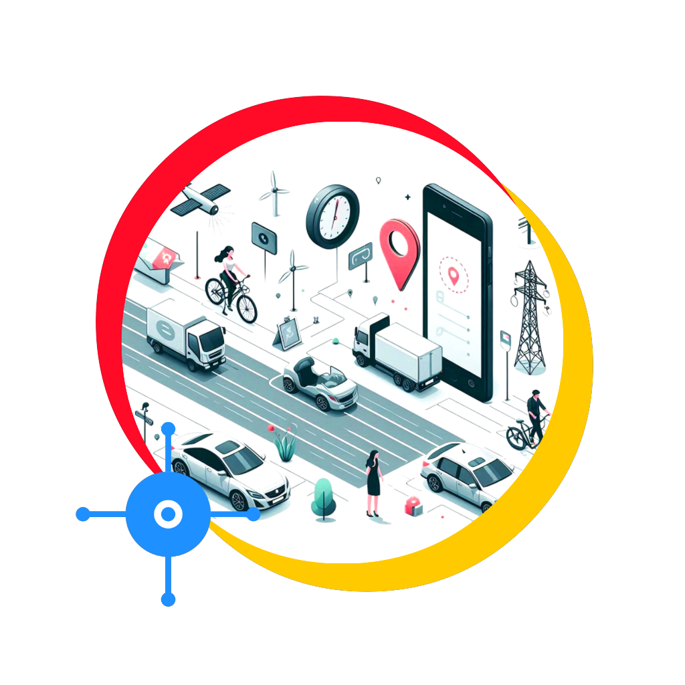
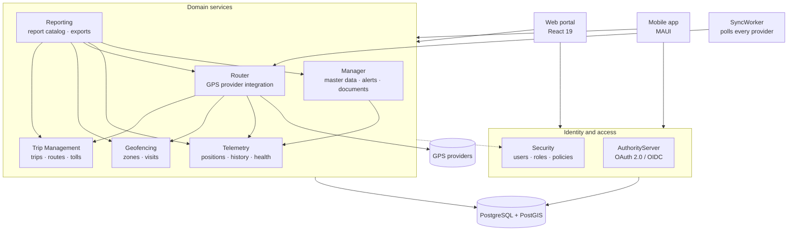

<div align="center">


# TrackHub

**One place for every fleet — whatever GPS platform each vehicle runs on.**

[English](README.md) · [Español](README.es.md)

[](LICENSE)
[](global.json)
[](TrackHub.Portal)
[](TrackHub.Deployment/QUICKSTART.md)
[](https://github.com/shernandezp/TrackHub/actions/workflows/ci.yml)



</div>

---

## What TrackHub is

Most organizations do not buy their GPS hardware from one vendor. They inherit it — a batch of
trackers from one supplier, a second platform that came with a leased fleet, a third that a
subsidiary already paid for. Each one ships its own portal, its own login and its own idea of what
a "trip" is.

**TrackHub is the layer above all of them.** It connects to each GPS provider through a pluggable
provider model, normalizes what they report, and gives the organization one live map, one set of
geofences, one trip board, one report catalog and one permission model over the whole fleet —
regardless of who supplied the hardware.

It is open source, self-hosted, multi-tenant and bilingual (English / Spanish), built as a
.NET 10 GraphQL microservice platform with a React 19 portal.

---

## Highlights

| | |
|---|---|
| **Live tracking** | Real-time map of every transporter and device across all connected providers, with replay and trip segmentation |
| **Multi-provider GPS integration** | Twenty GPS providers behind one Router service, with device management, manual sync, connectivity ping and derived operator health |
| **Geofencing** | Polygon and circle zones on both map providers, PostGIS containment detection, entry / exit / dwell alerts and visit history |
| **Trip management** | Zero-touch trip lifecycle — trips arm, start and complete from origin and stop zones — plus route plans, tolls, proof of delivery, ETAs and public tracking links |
| **Documents & workforce** | Versioned documents with signatures, sharing, expiration and retention; the staff registry with qualifications and assignment history |
| **Alerts & notifications** | Rule-driven alerts delivered in-app, by email, WhatsApp or webhook, with throttling, digests and escalation |
| **Reporting** | A governed catalog of 30 reports with in-app preview and Excel / PDF export |
| **Multi-tenancy** | Account lifecycle, per-account feature flags, branding, and a role + policy permission model enforced service-side |
| **Operability** | A public `/status` page that works without signing in, health checks per service, platform announcements and versioned Docker rollback |

---

## Architecture

Eight backend services, a background worker and a React portal, all speaking GraphQL (Reporting is
REST) and authenticated by the AuthorityServer.



How it fits together is in the wiki:
**[Architecture](https://github.com/shernandezp/TrackHub/wiki/Architecture)**,
**[Inter-Service Communication](https://github.com/shernandezp/TrackHub/wiki/Inter-Service-Communication)**,
**[Database](https://github.com/shernandezp/TrackHub/wiki/Database)**.

---

## Repository layout

Every service, the portal, the shared framework, the contract tests and the deployment tooling live
in this repository and build from one solution.

| Module | Purpose | Route prefix |
|---|---|---|
| [TrackHubCommon](TrackHubCommon) | Shared framework (domain, request pipeline, GraphQL, infrastructure, PDF), consumed as a ProjectReference | — |
| [TrackHub.AuthorityServer](TrackHub.AuthorityServer) | Authorization service — OAuth 2.0 / OpenID Connect, login, tokens | `/Identity/` |
| [TrackHubSecurity](TrackHubSecurity) | Security API — users, roles, policies, permissions, service clients | `/Security/` |
| [TrackHub.Manager](TrackHub.Manager) | Management API — accounts, assets, operators, documents, workforce, alerts | `/Manager/` |
| [TrackHubRouter](TrackHubRouter) | Router API and SyncWorker — GPS provider integration | `/Router/` |
| [TrackHub.Telemetry](TrackHub.Telemetry) | Telemetry API — positions, history, operator health | `/Telemetry/` |
| [TrackHub.Geofencing](TrackHub.Geofencing) | Geofencing API — zones, containment detection, visits | `/Geofence/` |
| [TrackHub.TripManagement](TrackHub.TripManagement) | Trip Management API — trips, stops, routes, tolls, public tracking | `/Trip/` |
| [TrackHub.Reporting](TrackHub.Reporting) | Reporting API — governed report catalog, Excel / PDF export | `/Reporting/` |
| [TrackHub.Portal](TrackHub.Portal) | Web portal (React 19 + TypeScript) and the in-app help content | `/` |
| [TrackHub.IntegrationTests](TrackHub.IntegrationTests) | Cross-service GraphQL contract tests | — |
| [TrackHub.Deployment](TrackHub.Deployment) | Docker deployment for the whole stack | — |
| [TrackHubMobile](https://github.com/shernandezp/TrackHubMobile) | Mobile application — **separate repository** | — |

Each module folder has a short README: what it owns, how to build, run and test it on its own, and
the gotchas specific to it.

---

## Getting started

### Deploy the whole stack

A Linux host with Docker and PostgreSQL 14+ with PostGIS. Follow
**[QUICKSTART.md](TrackHub.Deployment/QUICKSTART.md)** end to end — the databases, migrations,
certificates and OAuth clients have to happen in that order. **[INSTALL.md](TrackHub.Deployment/INSTALL.md)**
covers configuration, upgrades, backups, rollback and troubleshooting.

### Build and test from source

Requires the .NET 10 SDK and, for the portal, Node.js 22.

```bash
git clone https://github.com/shernandezp/TrackHub.git
cd TrackHub

dotnet build TrackHub.slnx                       # the whole backend graph
dotnet test TrackHub.Manager                     # one service's tests
dotnet test TrackHub.IntegrationTests            # the cross-service contract suite

cd TrackHub.Portal && npm ci && npm run typecheck && npm test && npm run build
```

Each service also has its own `.slnx`, for working on it without loading the whole graph.

### Run services locally

- **Run the backend on local Docker and the portal on the Vite dev server** —
  [LOCAL-DOCKER.md](TrackHub.Deployment/LOCAL-DOCKER.md) (Windows, Docker Desktop, PostgreSQL on the
  host). Every committed `appsettings.json` and the portal's `.env` already point at that stack
  (`https://trackhub.local:8443`), so a single service can be pulled out into the debugger while the
  rest keep running in containers.
- **The database schema comes from EF Core migrations**, never from the seeders. Each owning
  service's README has its `dotnet ef database update` command; the committed connection strings
  target `localhost:5432` as `postgres`.
- **Every service loads the OpenIddict signing certificate** from `OpenIddict:Path`
  (`C:\Certificates\certificate.pfx`, password `openiddict` in the committed settings). All
  processes that mint or validate tokens must share the same file.

---

## Technology

| | |
|---|---|
| **Backend** | .NET 10, HotChocolate GraphQL, EF Core + Npgsql, NetTopologySuite, FluentValidation, Serilog, OpenIddict |
| **Frontend** | React 19, TypeScript 7, Vite 8, MUI 9, TanStack Query, Vitest 5, Playwright, Leaflet / Google Maps |
| **Data** | PostgreSQL 14+ with PostGIS — two databases (`TrackHub`, `TrackHubSecurity`), one schema per service |
| **Integration** | GraphQL everywhere, including service-to-service; OAuth 2.0 client credentials for service identities |
| **Delivery** | Docker Compose behind nginx, GitHub Actions CI, versioned images with one-command rollback |

---

## Documentation

| | |
|---|---|
| **Technical** | The [TrackHub wiki](https://github.com/shernandezp/TrackHub/wiki) — [Architecture](https://github.com/shernandezp/TrackHub/wiki/Architecture), [Technology](https://github.com/shernandezp/TrackHub/wiki/Technology), [Database](https://github.com/shernandezp/TrackHub/wiki/Database), [Security and Identity](https://github.com/shernandezp/TrackHub/wiki/Security-and-Identity), [Frontend](https://github.com/shernandezp/TrackHub/wiki/Frontend), [Testing Strategy](https://github.com/shernandezp/TrackHub/wiki/Testing-Strategy) |
| **Adding a GPS provider** | [Adding a Provider](https://github.com/shernandezp/TrackHub/wiki/Adding-a-Provider) |
| **Deployment & operations** | [Deployment and Operations](https://github.com/shernandezp/TrackHub/wiki/Deployment-and-Operations) · [QUICKSTART](TrackHub.Deployment/QUICKSTART.md) · [INSTALL](TrackHub.Deployment/INSTALL.md) |
| **Permissions** | [User Permissions Overview](https://github.com/shernandezp/TrackHub/wiki/User-Permissions-Overview) |
| **User documentation** | In the app — the Help button or **F1** on any screen, in English and Spanish |

---

## Contributing

TrackHub is built to be extended — new GPS providers, new reports, new integrations. Contributions
are welcome.

- Read [Coding Standards](https://github.com/shernandezp/TrackHub/wiki/Coding-Standards) and
  [Architecture](https://github.com/shernandezp/TrackHub/wiki/Architecture) first — the layering and
  CQRS conventions are enforced consistently across all services.
- Branch from `develop`, keep `dotnet build TrackHub.slnx` green, and add tests beside the code you
  change.
- Open a pull request; CI builds the whole graph and runs the tests of every affected service, the
  contract suite, and the portal checks.

---

## License

Licensed under the **Apache License 2.0** — see [LICENSE](LICENSE).
